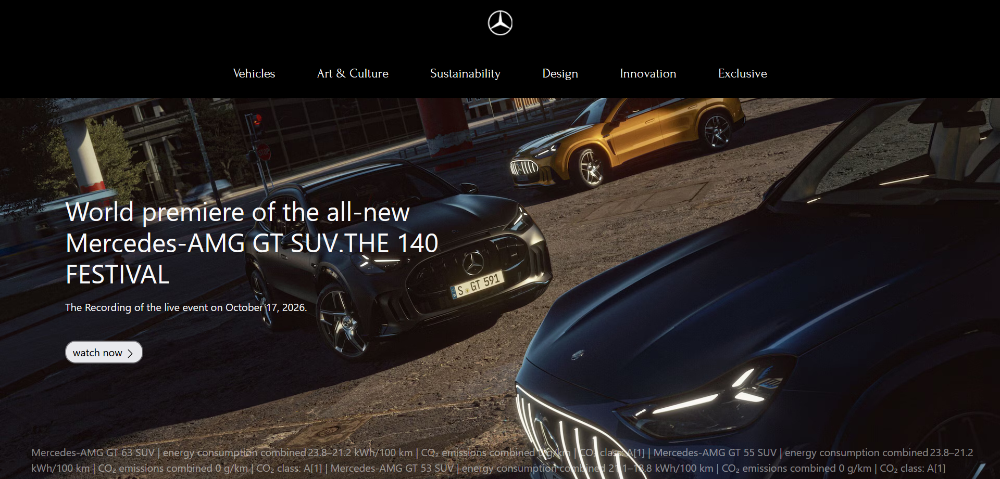

<div align="center">


# Mercedes-Benz

**A modern, responsive front-end tribute to the three-pointed star.**

[


](https://zhraakbariweb.github.io/Mercedes-Benz/)
[


](#)
[


](#)
[


](#)
[


](#-license)

[🌐 Live Demo](https://zhraakbariweb.github.io/Mercedes-Benz/) · [🐛 Report Bug](../../issues) · [✨ Request Feature](../../issues)

</div>

---

## 📖 About

**Mercedes-Benz** is a sleek, responsive website inspired by the official Mercedes-Benz brand experience. It features a clean navigation, a cinematic hero section and a premium look and feel, showcasing the **world premiere of the all-new Mercedes-AMG GT SUV** from *THE 140 FESTIVAL*.

> 🔗 **Live:** https://zhraakbariweb.github.io/Mercedes-Benz/

---

## ✨ Features

- 🎨 **Elegant, minimal design** that reflects the luxury of the brand
- 📱 **Fully responsive** across mobile, tablet and desktop
- 🧭 **Clear navigation:** Vehicles, Art & Culture, Sustainability, Design, Innovation, Exclusive
- 🎬 **Hero section** featuring the AMG GT SUV premiere
- ⚡ **Fast and lightweight**, with no heavy dependencies
- 🚀 **Deployed on GitHub Pages**

---

## 🛠️ Tech Stack

| Technology | Purpose |
|------------|---------|
| **HTML5** | Page structure and semantics |
| **CSS3** | Styling, layout and responsiveness |
| **JavaScript** | Interactivity and UI behavior |
| **GitHub Pages** | Hosting and deployment |

---

## 📂 Project Structure

```
Mercedes-Benz/
├── assets/
│   ├── img/
│   ├── css/
│   └── js/
├── index.html
└── README.md
```

---

## 🚀 Getting Started

Clone the repository and open it locally:

```bash
# Clone the repo
git clone https://github.com/zhraakbariweb/Mercedes-Benz.git

# Go to the project folder
cd Mercedes-Benz

# Open index.html in your browser
```

Or use a local server such as the VS Code **Live Server** extension.

---

## 📸 Preview

<div align="center">





</div>

> Add a screenshot of your site to `assets/img/preview.png`.

---

## 🗺️ Roadmap

- [x] Responsive hero section
- [x] Main navigation
- [ ] Vehicles gallery
- [ ] Dark / Light mode
- [ ] Multi-language support
- [ ] Animations and transitions

---

## 🤝 Contributing

Contributions are welcome!

1. Fork the project
2. Create your branch: `git checkout -b feature/AmazingFeature`
3. Commit your changes: `git commit -m "Add AmazingFeature"`
4. Push to the branch: `git push origin feature/AmazingFeature`
5. Open a Pull Request

---

## ⚠️ Disclaimer

This is a **non-commercial, educational project** created for learning and portfolio purposes. All trademarks, logos and brand names belong to **Mercedes-Benz Group AG**. This project is not affiliated with or endorsed by Mercedes-Benz.

---

## 📄 License

Distributed under the **MIT License**. See `LICENSE` for more information.

---

<div align="center">

Made with ❤️ by [zhraakbariweb](https://github.com/zhraakbariweb)

⭐ If you like this project, give it a star!

</div>
